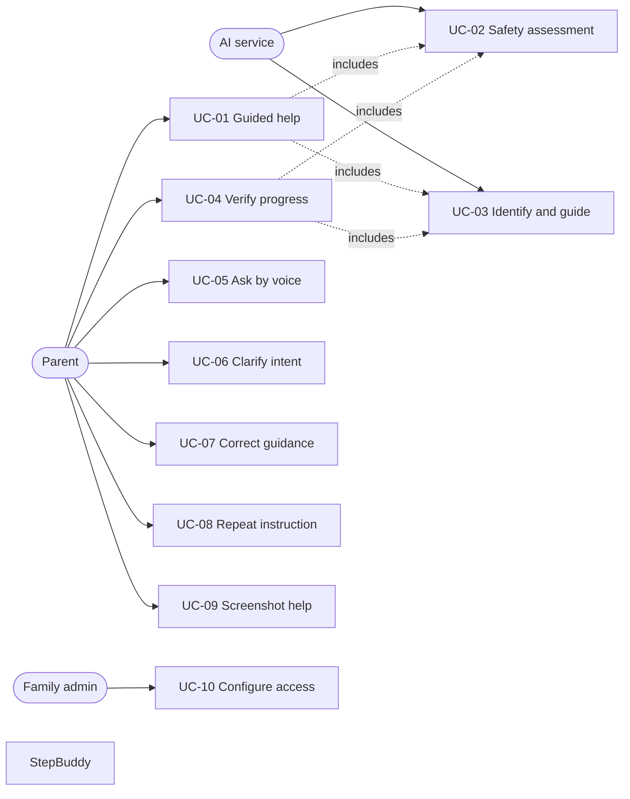
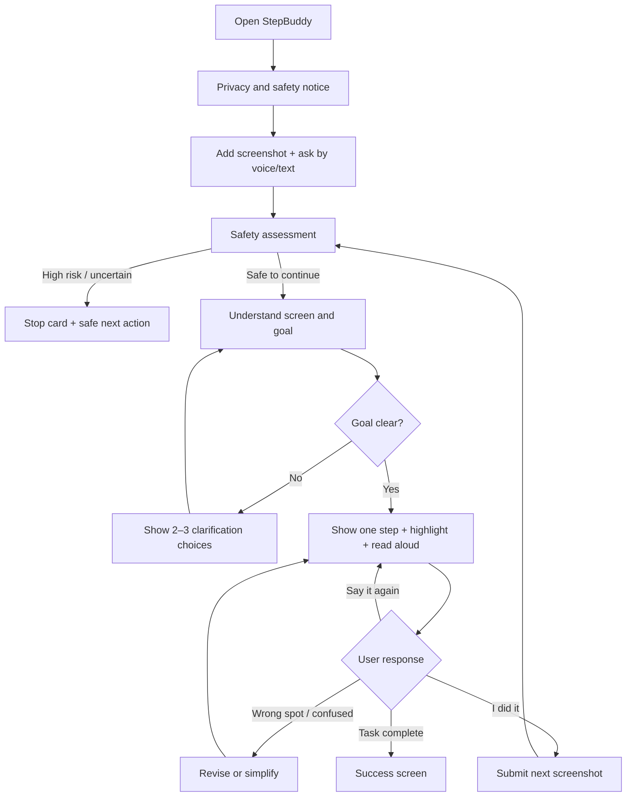
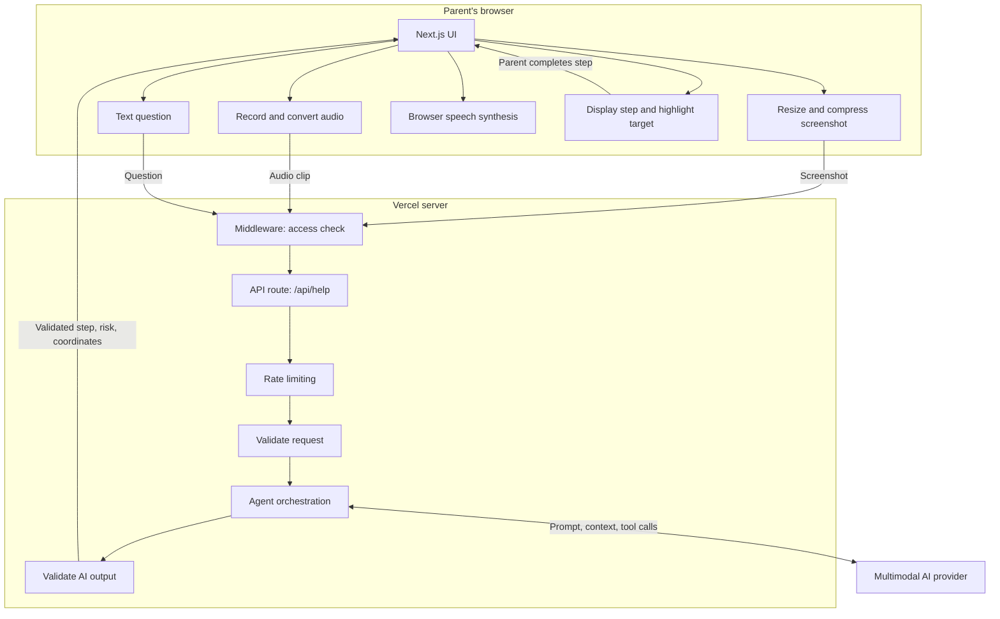
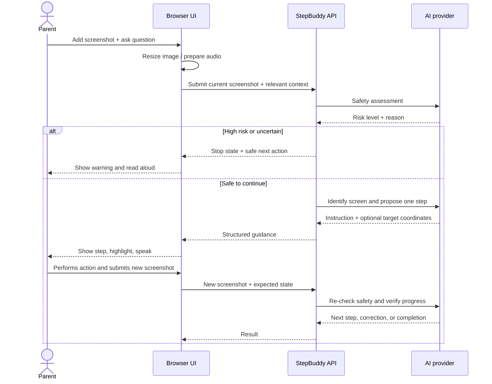

# StepBuddy — Product Requirements Document

## 1. Product summary

StepBuddy is a patient, step-by-step technology helper for parents and older adults. A user shares a screenshot and asks for help by voice or text. StepBuddy interprets the screen, checks for safety concerns, and explains **one next action at a time**. It highlights the relevant area of the screenshot, reads the instruction aloud, and asks the user to share a new screenshot to verify progress.

**Core experience:** Look → Understand → Guide → Verify → Repeat.

## 2. Problem

Everyday phone and computer tasks can become difficult when interfaces are unfamiliar, text is small, instructions are written in another language, or the user is afraid of making a mistake. Family members often provide remote support by asking the parent to describe a screen they cannot see. This is slow, frustrating, and can leave the parent feeling dependent.

The same uncertainty can make suspicious prompts and scam screens harder to evaluate. StepBuddy should help users pause and recognize risk—not encourage them to proceed through sensitive or financial actions.

## 3. Product vision and principles

Help people feel capable and safe using their devices, without making them feel rushed or dependent.

### Product principles
- **One step at a time:** Never overwhelm the user with a long checklist.
- **Patient, respectful language:** Explain without jargon or infantilizing the user.
- **Show, don't only tell:** Point to the relevant screen area when possible.
- **Verify before continuing:** Use the next screenshot to confirm progress.
- **Safety before completion:** When a screen appears risky, stop the task and explain why.
- **Privacy by design:** Minimize what is transmitted and retained; explain clearly what is sent to the AI provider.

## 4. Target users and personas

| Persona | Context | Needs | Frustrations |
|---|---|---|---|
| **Amma — primary user** | Retired teacher; Android phone; prefers Tamil; uses WhatsApp and YouTube | Simple steps, large text, voice input/output, reassurance | Small controls, English menus, fear of bothering family |
| **Appa — primary user** | Retired; uses phone and laptop; mixes English and his first language | Help with settings and everyday forms; confidence before tapping | Jargon, too many instructions, fear of mistakes or scams |
| **Adult child — setup/support user** | Busy, may live in another city | Easy setup, confidence in safety, reasonable abuse/rate-limit controls | Long calls spent trying to guess the parent's screen |

These personas are hypotheses. Validate them by observing real users complete tasks; do not treat the illustrative details as research findings.

## 5. Goals and non-goals

### V1 goals
- Help a user complete a common, low-risk device task without calling family.
- Analyze each new screenshot for safety concerns before giving the next instruction.
- Provide a single, actionable next step in the user's language.
- Highlight the relevant screen area when the model can identify it reliably.
- Support voice and text input, with spoken responses where the browser/device supports them.
- Work in a modern browser without installing a native app.
- Keep infrastructure costs within a defined free-tier budget during the prototype; verify provider and hosting limits before launch.

### V1 non-goals
- Remote control, automatic tapping, or direct device access.
- Live screen sharing or video; screenshots only.
- Accounts, cloud conversation history, or a family dashboard.
- Native iOS or Android apps.
- Full translation of every app control; AI responses may be multilingual while the interface initially remains English.
- Guidance through high-risk financial, identity, security, or medical actions.

## 6. Scope and release definition

### In scope
- Screenshot upload from camera roll/gallery or file picker.
- Typed or recorded question.
- Screen understanding and task clarification.
- Safety assessment on each newly submitted screenshot.
- One-step instruction with optional screenshot annotation.
- Text-to-speech, repeat instruction, progress verification, correction, and completion.
- Basic screenshot-taking help.
- Optional family access code for a private prototype.

### Out of scope for V1
- Remote device support or unattended automation.
- Persistent user profiles and saved sessions.
- Child-facing analytics or weekly reports.
- Android share-sheet integration and replayable saved guides.

### V1 release criteria
V1 is ready for family testing when the end-to-end loop works on supported devices, safety-stop behavior is tested, no API secret is exposed to the browser, and the privacy/provider disclosure is visible before screenshot submission.

## 7. Primary user journey

1. User opens StepBuddy and sees a brief privacy/safety notice.
2. User adds a screenshot and asks a question by voice or text.
3. StepBuddy checks the screenshot for sensitive information and potential scam indicators.
4. If risk is high, StepBuddy displays a clear stop message and safe next actions; it does not continue the original task.
5. Otherwise, StepBuddy identifies the screen and the user's goal.
6. If the goal is unclear, it asks one short question with 2–3 large options.
7. StepBuddy displays and reads one next step, highlighting the target if confidence is sufficient.
8. User performs the action and submits a new screenshot.
9. StepBuddy checks whether the expected state is reached and either gives the next step, corrects the guidance, or confirms completion.

## 8. Use cases

| ID | Use case | Actor | Outcome |
|---|---|---|---|
| UC-01 | Get guided help | Parent | Receives the first safe, actionable step |
| UC-02 | Assess screenshot safety | StepBuddy AI | Risk level and reason are evaluated before guidance |
| UC-03 | Identify screen and target | StepBuddy AI | Screen context and intended target are identified |
| UC-04 | Verify progress | Parent + AI | Next step, correction, or completion is shown |
| UC-05 | Ask by voice | Parent | Speech is transcribed/understood and response uses the user's language when supported |
| UC-06 | Clarify intent | Parent + AI | User chooses from a small set of options |
| UC-07 | Correct guidance | Parent | AI re-explains or revises the target |
| UC-08 | Repeat instruction | Parent | Current instruction is spoken again |
| UC-09 | Learn to take a screenshot | Parent | Device-specific screenshot instructions are shown |
| UC-10 | Configure family access | Adult child/admin | Private prototype access is configured |

## 9. Use case diagram

## 10. Functional requirements

| ID | Requirement | Priority |
|---|---|---|
| FR-01 | User can select a screenshot from gallery or file picker. | Must |
| FR-02 | Browser resizes/compresses the image before upload, targeting ~1280 px on the longest edge. | Must |
| FR-03 | User can enter a question by text. | Must |
| FR-04 | User can record a short voice question; supported audio is sent for language understanding. | Must |
| FR-05 | Every newly submitted screenshot receives a safety assessment before task guidance. | Must |
| FR-06 | High-risk results show a prominent stop/warning state and safe next steps. | Must |
| FR-07 | AI provides exactly one next action per guidance turn. | Must |
| FR-08 | If target coordinates are returned with sufficient confidence, UI highlights the target on the screenshot. | Must |
| FR-09 | The instruction is displayed in text and may be read aloud automatically; user can replay it. | Must |
| FR-10 | “I did it” allows the user to submit a new screenshot for verification. | Must |
| FR-11 | “Wrong spot” and “I'm confused” request revised or simpler guidance. | Must |
| FR-12 | When intent is unclear, AI asks a short clarification with 2–3 large choices. | Should |
| FR-13 | Static screenshot instructions are available for Android, iPhone, Windows, and Mac. | Should |
| FR-14 | A family access code can restrict the prototype UI/API. | Should |
| FR-15 | App can be added to the home screen using a web manifest. | Could |

## 11. Non-functional requirements

| Area | Requirement |
|---|---|
| Accessibility | Base text ≥20 px where practical; primary controls ≥56 px high; max 3 choices; WCAG AA contrast; reduced-motion support; readable font such as Atkinson Hyperlegible. |
| Usability | First-time user reaches the first instruction in ≤3 primary actions after opening the app. |
| Performance | Target first instruction within 10 seconds on a typical 4G connection; show progress and recoverable errors. |
| Request size | Send only the current screenshot and necessary recent context; cap voice recording duration and enforce request-size limits. |
| Privacy | Avoid server-side conversation storage by default; disclose that screenshot/audio data is sent to the AI provider and explain applicable provider retention/training terms. |
| Safety | Never request or repeat passwords, OTPs, PINs, recovery codes, or full payment-card details; do not guide risky actions. |
| Cost | Prototype should remain within free-tier quotas where available; free tiers and terms can change and must be checked before launch. |
| Compatibility | Current Chrome, Safari, Edge, and Firefox on Android, iOS, Windows, and macOS; microphone requires HTTPS and permission. |
| Reliability | Rate-limit and network errors show plain-language guidance and a retry option without losing the user's current input. |

## 12. Safety and privacy requirements

- Show a plain-language notice before the first upload: screenshots and optional audio are processed by an external AI provider; users should avoid sharing private or sensitive screens.
- Detect or warn about visible OTPs, passwords, banking/payment screens, identity documents, and other sensitive information. Detection is imperfect; the notice must not imply complete protection.
- Treat scam assessment as a precaution, not a guarantee. When uncertain, advise the user to stop and verify through an official channel or trusted person.
- Do not instruct users to install remote-access apps, share verification codes, approve unknown payment requests, or bypass security warnings.
- Never expose AI provider keys in client-side code. Keep secrets in server environment variables.
- Do not store screenshots/audio/conversations unless a future feature explicitly requires it and users consent.
- A family code is a basic access gate, not strong identity verification or guaranteed quota protection. Use server-side rate limiting as well.

## 13. UX and interaction states

### Main states
- Empty/help home
- Screenshot selected
- Listening / recording
- Analyzing (with calm progress feedback)
- Clarification required
- Guidance step
- Safety stop
- Verifying screenshot
- Corrective guidance
- Task complete
- Recoverable error / rate limited

### Guidance card
Each step should contain:
- One short action sentence
- Button label, color, or location when relevant
- Optional target box/circle on screenshot
- “I did it”, “Wrong spot”, “I'm confused”, and “Say it again” actions

## 14. User flow

## 15. System architecture

The browser handles the interface and local media preparation. A server-side API route validates requests, calls the AI provider, and returns structured results. The AI provider is responsible for multimodal interpretation; the UI renders the instruction and annotation.

**Data handling:** The browser retains the active session in memory/session state. The server should not persist screenshots, audio, or chat history. Requests may still be processed or retained by the AI provider according to its current terms; confirm those terms and communicate them accurately.

## 16. Agent interaction / sequence diagram

## 17. Technical decisions (initial proposal)

| Layer | Proposed choice | Notes |
|---|---|---|
| Framework | Next.js App Router + TypeScript | UI and API in one repository |
| Styling | Tailwind CSS | Large, consistent accessible controls |
| Motion | Framer Motion or CSS | Keep motion subtle; respect reduced-motion |
| AI integration | Vercel AI SDK with provider adapter | Verify compatible SDK/provider versions during implementation |
| Model | Multimodal Gemini Flash-family model | Model name, availability, quotas, and terms are configuration decisions—not fixed product guarantees |
| Validation | Zod | Validate inputs and structured model outputs |
| Voice input | Browser MediaRecorder + supported audio format | Do not assume WAV conversion is required or universally supported; test browsers |
| Voice output | Browser speechSynthesis | Voice/language availability varies by device |
| Hosting | Vercel | Confirm Hobby plan usage and commercial restrictions before public launch |
| Repository/deploy | GitHub + Vercel deployment | Keep secrets in environment variables |

## 18. Risks and mitigations

| Risk | Impact | Mitigation |
|---|---|---|
| Incorrect target highlight | User taps wrong control | Pair highlight with label/location text; require confidence threshold; allow “Wrong spot” |
| Scam or sensitive content missed | User may follow unsafe instructions | Safety-first workflow, conservative stop behavior, clear disclaimer, test cases; never claim perfect detection |
| AI provider terms or free quota change | Service may become unavailable or cost money | Keep provider/model configurable; monitor quota; define a cost ceiling and fallback message |
| Sensitive screenshot sent externally | Privacy harm | Pre-upload notice, minimize image/audio, avoid storage, provide cancel/remove option before sending |
| Voice unavailable in user's language | User cannot hear response | Always show text; provide replay and device voice setup guidance |
| Too much complexity | User abandons flow | One action per turn; usability testing with real parents |
| Oversized or slow requests | Upload or response failure | Compress image, cap audio, limit context, show progress and retry |
| Family code shared beyond family | Unauthorized use/quota abuse | Server-side rate limiting, rotate code, treat code as lightweight access control only |

## 19. Success metrics and validation

**North-star metric:** Percentage of observed test tasks completed safely without calling a family member.

| Metric | Initial target | Measurement |
|---|---|---|
| Tasks completed without family help | 8/10 observed tasks | Moderated usability sessions |
| Correct target highlight | ≥9/10 tested steps where a target exists | Compare model target with observed correct control |
| Safety test coverage | 5/5 predefined high-risk test screenshots trigger safe-stop behavior | Test fake prize, OTP, KYC, remote-access, and payment-request examples |
| Language response | 10/10 test prompts answered in expected language across supported languages | Voice/text test set; record unsupported cases honestly |
| Time to first instruction | <10 seconds on test 4G | Stopwatch/logging without retaining sensitive media |
| Cost | Within prototype budget | Provider and hosting dashboards |

Targets are prototype acceptance criteria, not claims of proven performance. Run tests with varied devices, screen sizes, languages, and real users before public release.

## 20. Roadmap

| Milestone | Deliverable |
|---|---|
| M0 — Product definition | PRD, flow, architecture, safety boundaries |
| M1 — Agent foundation | Server route, structured output, safety and guidance tools; test with sample screenshots |
| M2 — Core UI | Screenshot picker, instruction card, target overlay, safety state |
| M3 — Voice | Short voice input, multilingual response, speech playback and replay |
| M4 — Verification and polish | “I did it”, verification loop, correction states, completion, screenshot guide, access gate |
| M5 — Family pilot | Deploy, test on parents' devices, observe 10 tasks, fix points of confusion |

### Later ideas (not V1)
- Weekly progress summary for the adult child
- Localized interface controls
- Android share-menu shortcut
- Saved/replayable task guides

## 21. Open decisions

- Which languages and device/browser combinations are explicitly supported in the first pilot?
- What exact provider terms apply to screenshot/audio processing on the chosen plan?
- Should the safety system block all banking/payment screens, or allow only non-sensitive navigation with strict limits?
- What confidence threshold is required before rendering a target highlight?
- What rate limit and family-code rotation policy is appropriate for the pilot?
- What is the maximum acceptable per-user/per-month cost if free-tier availability changes?
